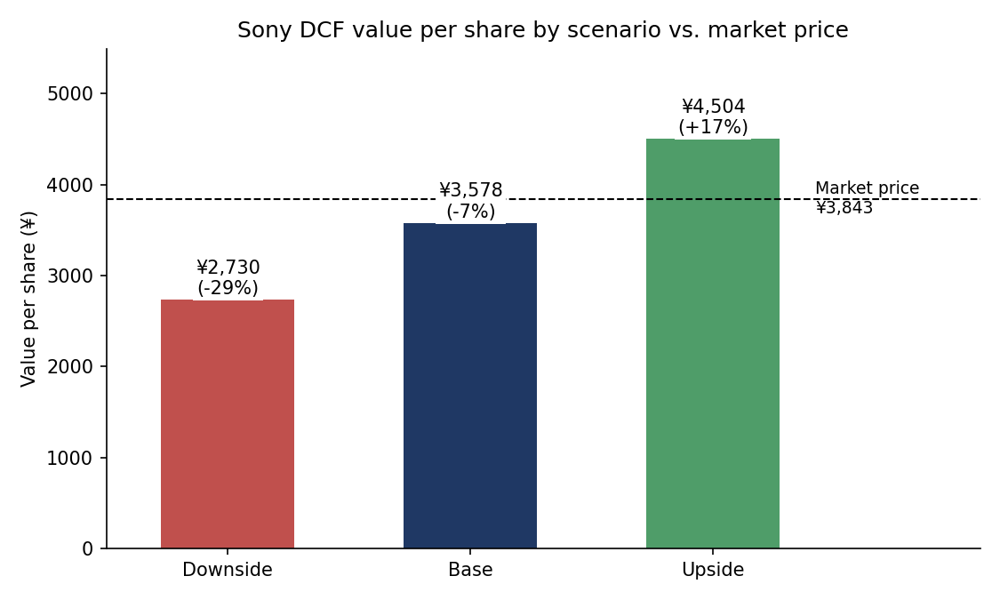
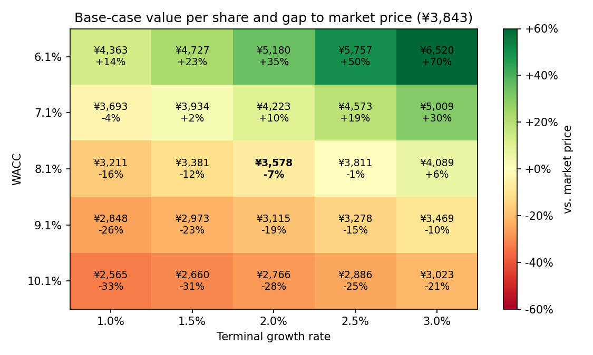
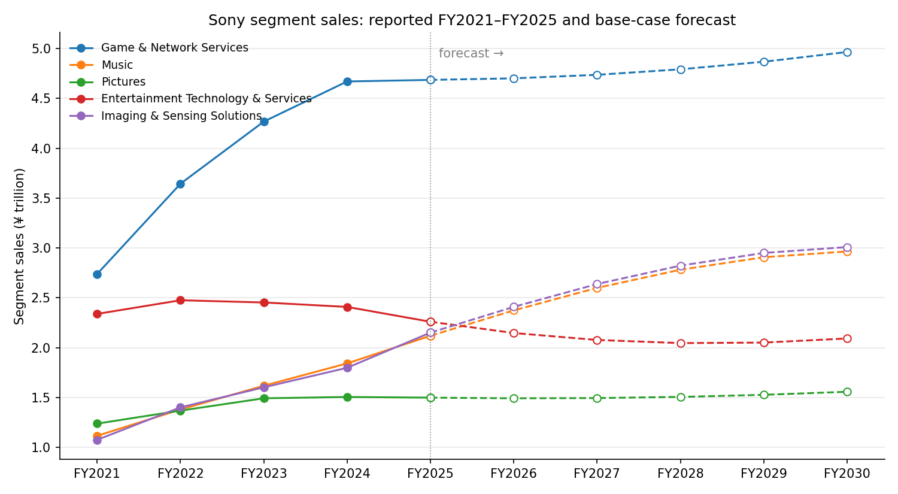
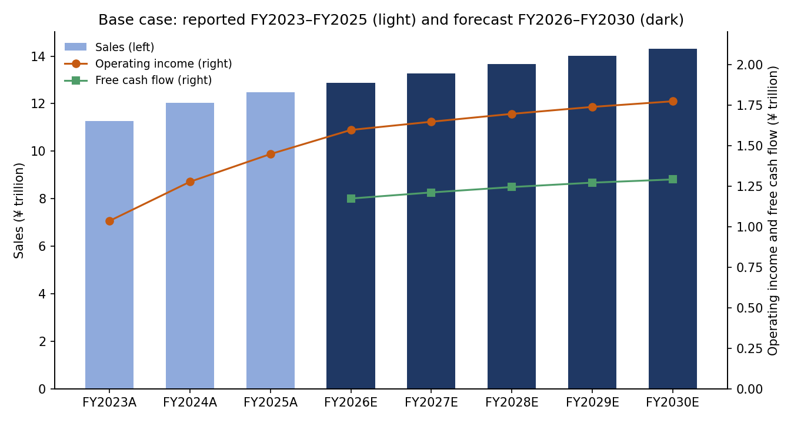

# Sony Group — Financial Forecast, Three-Statement Model & DCF Valuation

**Data:** Sony Group Corporation's [Form 20-F for FY2025](https://www.sec.gov/Archives/edgar/data/313838/000119312526274893/d28719d20f.htm) (fiscal year ended March 31, 2026), filed with the SEC — the company's own audited statements rather than a third-party dataset. Details in [`data/README.md`](./data).

**Deliverable:** [`sony_financial_model.xlsx`](./sony_financial_model.xlsx) — a linked Excel model with 1,840 live formulas, built and checked from Python.

## Business Question
What is Sony worth on its own cash flows, and how does that compare with what the market is paying? [Project 6](../06-sony-stock-technical-analysis) showed that Sony's price history cannot predict its future price; this project values the business from its fundamentals instead.

## Approach
The three models are connected: the revenue forecast feeds the three statements, and the statements' cash flows feed the valuation.

1. **Data preparation** — transcribe the income statement, balance sheet, cash flow and segment sales from the filing into [`data/`](./data), and check that every subtotal reconciles to the reported totals. Sony spun off Financial Services in FY2025, so the model covers continuing operations only.
2. **Revenue forecast** ([`forecast_revenue.py`](./forecast_revenue.py)) — backtest three growth rules per segment on hold-out years, use the most accurate to set each segment's starting growth, then fade growth to 2% by FY2030.
3. **Three-statement model** ([`build_model.py`](./build_model.py)) — sales drive costs, working capital and investment; net income flows to equity and cash flow; closing cash flows back to the balance sheet.
4. **DCF valuation** — free cash flow to the firm discounted at a CAPM-based WACC, with a Gordon-growth terminal value and a bridge from enterprise value to value per share.
5. **Scenario analysis** — the whole model is built three times (Base, Upside, Downside), each driven by its own column of assumptions, plus a WACC × terminal-growth sensitivity table.
6. **Dashboard** — headline valuation and charts inside the workbook.
7. **Verification** ([`verify_model.py`](./verify_model.py)) — recalculate every formula with an independent engine and assert that the statements tie.

## Key Findings
- **Base-case value is ¥3,578 per share ($22.49 per ADR), 7% below the ¥3,843 market price** (the $24.15 close on 2026-08-24 at ¥159.12 per dollar). On these assumptions Sony looks roughly fairly valued, not cheap.

  

- **The scenarios span ¥2,730 to ¥4,504 per share (−29% to +17% against the market).** The downside is larger than the upside, so the market price already assumes Sony does somewhat better than the base case.

  | | Downside | Base | Upside |
  |---|---|---|---|
  | Growth adjustment per year | −2 pts | — | +2 pts |
  | Cost of sales, % of sales | 70.7% | 69.2% | 68.2% |
  | Terminal growth | 1.5% | 2.0% | 2.5% |
  | Sales CAGR, FY2025–FY2030 | 0.8% | 2.8% | 4.8% |
  | FY2030 operating margin | 10.9% | 12.4% | 13.4% |
  | Enterprise value | ¥14.5tn | ¥19.5tn | ¥24.9tn |
  | **Value per share** | **¥2,730** | **¥3,578** | **¥4,504** |

- **The discount rate matters more than the forecast.** One point of WACC moves the base value from ¥3,578 to ¥4,223 (7.1%) or ¥3,115 (9.1%). WACC is 8.1%, built from a 3.03% Japanese government bond yield plus two inputs that are my assumptions and not estimated from data: a 5.5% equity risk premium and a beta of 1.0.

  

- **75% of enterprise value is terminal value** — most of the valuation rests on cash flows after FY2030, which is typical for a DCF but means the five-year forecast alone decides little.
- **Growth is shifting between segments.** Music (+15%) and Imaging & Sensing Solutions (+20%) grew fastest in FY2025, Game & Network Services was flat (+0.3%), and Entertainment Technology & Services shrank 6%. The base case carries that mix forward: sales grow 2.8% a year to ¥14.3tn by FY2030.

  

- **The simplest forecasting rule won.** "Next year grows like last year" had a sales-weighted error of 5.1% on the hold-out years, against 7.8% for a linear trend and 9.6% for a multi-year CAGR. With five annual data points per segment, anything more elaborate would be overfitting.
- **Base-case free cash flow is ¥1.17tn in FY2026, rising to ¥1.29tn in FY2030**, on an operating margin of 12.4% (11.6% reported in FY2025; the forecast assumes no repeat of that year's ¥98bn of other operating and equity-method losses).

  

## How the workbook is organised
| Sheet | Contents |
|---|---|
| `Cover` | Model map, colour code, integrity checks, simplifications |
| `Dashboard` | Six headline figures and four charts |
| `Historical` | Reported statements from the filing |
| `Assumptions` | Every driver with Base / Upside / Downside values and its source |
| `Base`, `Upside`, `Downside` | Revenue build → income statement → balance sheet → cash flow → free cash flow → DCF |
| `Scenarios` | Side-by-side results and the sensitivity table |

Inputs are blue, formulas black, cross-sheet links green, and key assumptions are highlighted yellow. Change any assumption and all three scenarios, the sensitivity table and the dashboard recalculate.

## Checks
`verify_model.py` recalculates the workbook and asserts, for all three scenarios and all five forecast years, that:
- assets equal liabilities plus equity,
- balance-sheet cash equals closing cash on the cash-flow statement,
- net income on the cash-flow statement equals the income statement,
- reported operating income for FY2023–FY2025 is reproduced from its components.

All checks pass with zero formula errors.

## Limitations
- **This is a learning project, not investment advice.** A different, equally defensible set of assumptions would move the answer by more than the 7% gap to the market price.
- **Beta and the equity risk premium are assumed**, not estimated; so are the interest rates, buybacks and the size of the scenario adjustments. Each is labelled as such on the `Assumptions` sheet.
- **Dates do not line up exactly:** the balance sheet is March 31, 2026, the share price August 24, 2026, and the bond yield October 9, 2026.
- **Simplified balance sheet:** PP&E, right-of-use, content and intangible assets are forecast as one line; debt, leases, goodwill and other long-term items are held flat; cash accumulates rather than being returned.
- **Only five years of segment history and three of restated statements** are available after the Financial Services spin-off, so the revenue forecast is a set of simple rules, not a statistical model.
- **Everything is in yen** — a dollar investor also bears exchange-rate risk that the model does not capture.

## Run it
```bash
pip install pandas matplotlib openpyxl formulas
python forecast_revenue.py
python build_model.py
python verify_model.py
```

## Files
- `sony_financial_model.xlsx` — the model
- `forecast_revenue.py` → `build_model.py` → `verify_model.py` — the pipeline that produces and checks it
- `data/` — reported statements, market inputs, forecast and backtest outputs
- `results/` — scenario summary, sensitivity table and base-case forecast as CSV
- `images/` — charts used above
